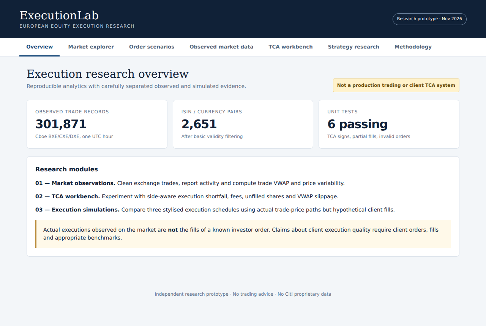
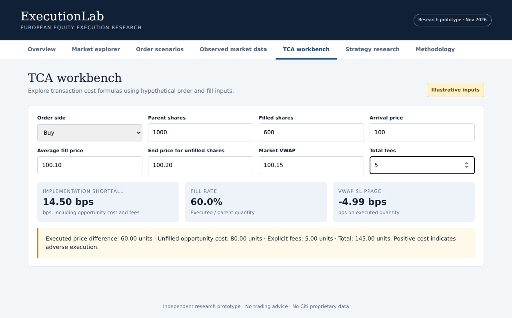

# ExecutionLab

**ExecutionLab is an interactive research dashboard for measuring the cost of executing an equity order.** It lets you change an order, see how much of it filled, and compare the result against different price benchmarks.

I work on electronic trading systems, so I wanted to follow an order beyond the point where it gets routed. How much did it cost to trade? What happens if the order never finishes? Could the same execution look good against one benchmark and expensive against another? That’s what transaction cost analysis (TCA) helps explain.



## One order tells the story

Imagine I want to **buy 1,000 shares** when the stock is at **£100.00**. Only **600 shares** fill, at **£100.10**. The stock ends the window at **£100.20**, and I pay **£5** in fees. The average market trade price, weighted by volume (VWAP), is **£100.15**.

| What the dashboard shows | What it means |
| --- | --- |
| **60% fill rate** | 600 of the 1,000 shares were executed. |
| **−4.99 bps versus VWAP** | The shares I bought cost less than the market’s volume-weighted average price. |
| **+14.50 bps implementation shortfall** | Relative to buying all 1,000 shares at arrival, I paid £60 more on the fills, missed £80 of price movement on the remaining shares, and paid £5 in fees. That’s £145 on the £100,000 intended order. |

One basis point (bp) is 0.01%. The same order can beat VWAP on the executed shares and still cost more than the arrival benchmark once the unfinished shares and fees are included.



## Try it locally

Open `dashboard.html` in a browser and select **TCA workbench**. Enter the example above, then change the end price and see which metrics move. The dashboard also links to the bundled market and strategy reports. Python 3 is enough to run the tests and regenerate the synthetic report.

```bash
python3 -m unittest discover -p 'test_*.py'
python3 analysis.py
```

## How the project works

| Part | Data | What it shows |
| --- | --- | --- |
| Trade analysis | Cboe Europe delayed prints from selected hours on 30 October and 2 November 2026 | Trade counts, volume, trade VWAP and price variation |
| Strategy comparison | Observed trade paths with hypothetical orders and fills | How immediate, equal-slice and volume-adaptive schedules behave under the model's assumptions |
| Quote replay | Separate Cboe BXE Trades & Quotes sample from 1 September 2020 | Top-of-book reconstruction and quoted spread diagnostics for two sample instruments |

The pipeline groups trade prints into minute bars, uses the same market path to simulate three ways of scheduling an order, then feeds each set of hypothetical fills through the TCA engine. The dashboard lets me inspect the outcomes side by side.

The initial hour included 301,871 trade records across 2,651 instrument and currency pairs. The expanded run covered 436,424 trade records and 336 hypothetical scenarios. These are narrow samples. The 2020 quotes and 2026 trades stay separate, and there are no observed client fills. See [the research notes](RESEARCH.md) and [the replay validation log](VALIDATION.md) for the results and their limitations.

## Reproduce the market studies

Download permitted data from [Cboe Europe](https://www.cboe.com/europe/equities/trade_data) or [Cboe DataShop](https://datashop.cboe.com/). The raw files stay local under the provider's terms. Pass all the desired trade files to each script and substitute your own filenames.

```bash
python3 real_market_study.py path/to/bxe.csv path/to/cxe.csv
python3 strategy_study.py path/to/bxe.csv path/to/cxe.csv
python3 research_v4.py path/to/bxe.csv path/to/cxe.csv
python3 build_dashboard.py
python3 quote_sample_report.py path/to/cboe_taq_sample.zip
```

Open `dashboard_interactive.html` after the build for the instrument and venue explorer and scenario drill-down. The generated dashboard and its data payloads stay local.

## Where the logic lives

- `tca_engine.py` calculates arrival-price shortfall, missed-fill opportunity cost, fees, fill rate and VWAP slippage. Positive cost means worse execution for both buys and sells.
- `research_v4.py` groups trade prints into minute bars and compares schedules across repeated hypothetical parent orders.
- `cboe_sample_book.py` replays visible order events to reconstruct the best bid and ask. The validation log explains what was checked and where an independent exchange snapshot would help.
- `quote_analysis.py` matches trades to the latest eligible quote at or before the trade on the same instrument and venue, within a configurable age limit. For quotes with the same timestamp it uses the last valid update in file order. Effective spread requires a supplied buy or sell side.

## What I’d test next

I’d reconcile the replay against independent snapshots, collect more matched trade and quote sessions, and test the simulation on later dates with a wider range of participation, spread and impact assumptions. [The prospective study design](STUDY_DESIGN.md) spells out the hypotheses and data rules. To make claims about client execution quality, I’d also need actual parent orders and fills.

This is independent research using public market samples and synthetic orders. It uses no employer systems, client information or proprietary code.
